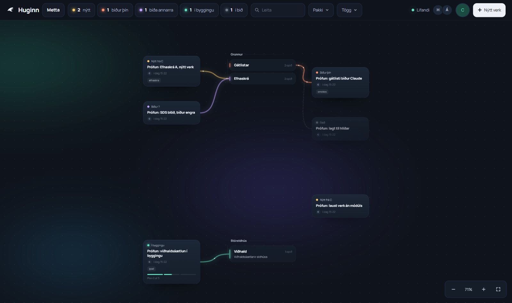
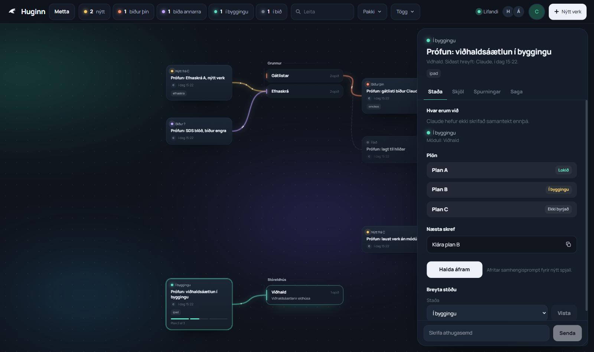
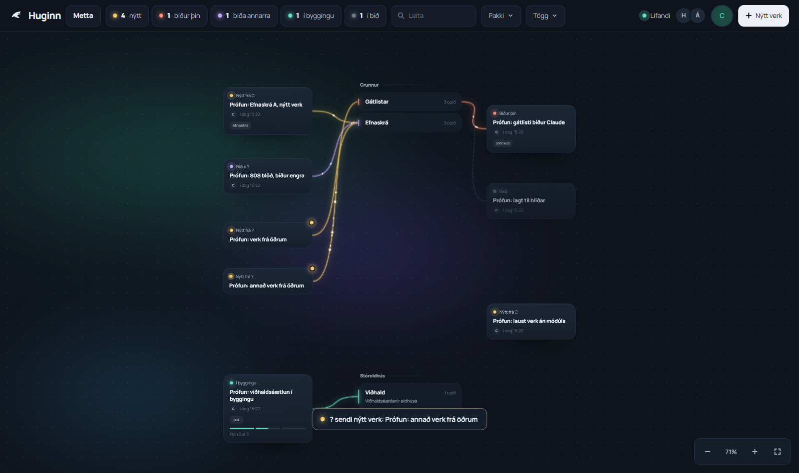
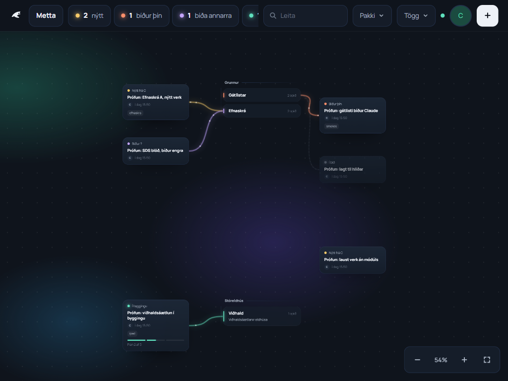
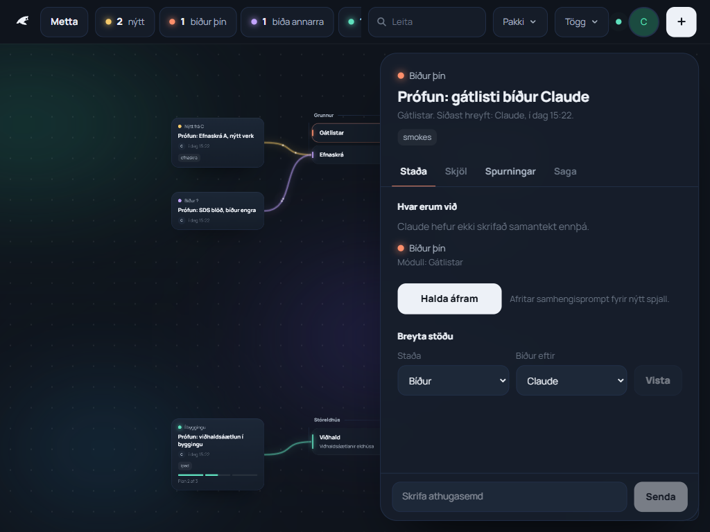
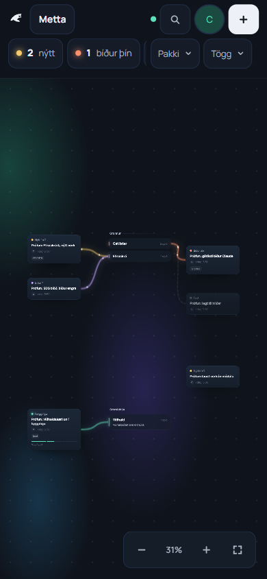
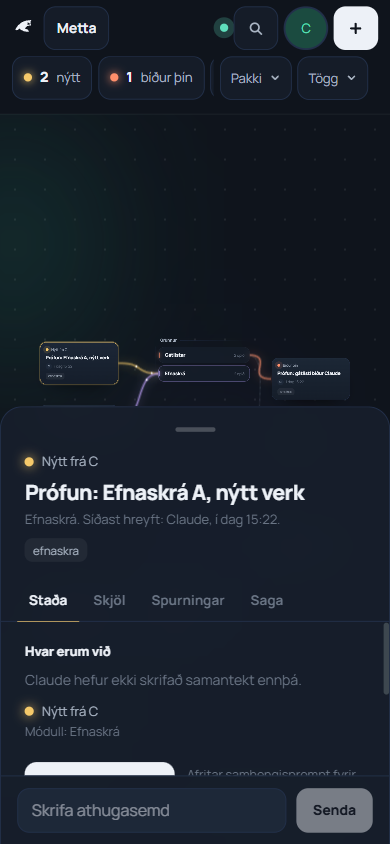
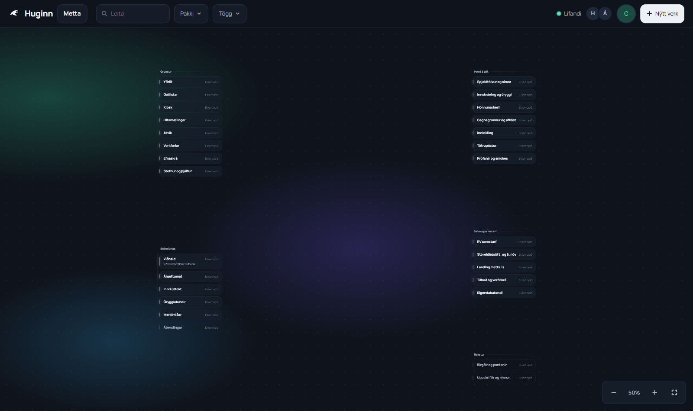

# 02 Vinnuborð: borðið (plan 2)

Dagsetning: 2026-10-31
Grein: `vinnubord-2` (ekki pushuð, Heimir pushar)
Plan: `docs/superpowers/plans/2026-10-31-vinnubord-2-bord.md`
Spekk: `docs/superpowers/specs/2026-10-31-huginn-vinnubord-design.md`

## Hvað var gert

- **Verk 1:** tákn (`--hg-*` í `src/vinnubord/vinnubord.css`), `useViewport` (pan, hjól, pinch, tveir fingur), `geometry.ts` (sýn, aðdráttur, passa allt, bezier), letur (Manrope).
- **Verk 2:** pakkadálkar og módúlspjöld (`PackColumn`, `ModuleCard`, `layout.ts`), draugamódúlar, "hot" hringur.
- **Verk 3:** verkaspjöld (`ItemCard`), dráttur með fjöðrun (`useCardDrag`, `spring.ts`), þræðir á canvas með neistum (`Wires`), talningarflokkar (`countBucket`), ólesið (`reads.ts`), framvindustikur plana. Dráttur breytir bara `pos_x` og `pos_y`.
- **Verk 4:** hliðarspjald á tölvu og botnblað á síma (`PanelShell`, `ItemPanel`, `ModulePanel`), flipar Staða, Skjöl, Spurningar og Saga, athugasemdir, afritunartakki með fallback, Markdown lesari (marked og DOMPurify, löt hleðsla). `jsdom` er aðeins dev pakki fyrir eitt hreinsunarpróf.
- **Verk 5:** toppstika (teljarar sem sía, leit, Pakki og Tögg valmyndir, lifandi punktur af realtime rás, valmynd notanda með stillingum, tungumáli og útskráningu), `useFilter` í sessionStorage, blað fyrir nýtt verk með skráahleðslu og staðsetningu (`placement.ts`).
- **Verk 6:** eitt token yfirlit yfir allt CSS, norðurljós, innkoma með fjöðrun og þræðir teiknaðir upp, tilkynning þegar annar sendir nýtt verk, `prefers-reduced-motion` slekkur á hreyfingu.
- **Verk 7:** stillingasíða `/p/:slug/stillingar` (verkefni, pakkar, módúlar, þátttakendur), migration `0005_hg_add_participant` keyrð með MCP, gamla `SettingsStubPage` farin. Verkefnið metta fyllt: 5 pakkar og 28 módúlar (Grunnur, Stóreldhús og módúlarnir úr fyrri prófunum nýttir, ekki tvíteknir).
- **Verk 8:** þessi skrá og CLAUDE.md.

Úr plani 1: útskráningarhnappur er kominn (valmynd notanda). Spurningu má aðeins svara einu sinni úr viðmótinu, svo `answered_by` vandinn úr plani 1 kemur ekki upp.

## Staðfesting

Keyrt í verki 8, 2026-10-31:

- `npm run build`: grænt (`built in 1.26s`).
- `npm run test`: `Test Files 20 passed (20)`, `Tests 212 passed (212)`.
- `npm run smoke:hg`: `ok 6/6`.

## Handpróf

Öll á lifandi gögnum metta, innskráð sem Claude, í Playwright. Engu eytt á lifandi gögnum.

- **Chromium, 1600x950, mús:** hleðsla, passa allt, dráttur með fjöðrun, staða vistuð og komin aftur eftir endurhleðslu, þráður fylgir spjaldi, aðdráttur með hjóli og hnöppum, fjarbreyting með realtime (spjald fylgir), fjarbreyting meðan dregið er (sá sem sleppir síðast vinnur), ólesið ljómar, `prefers-reduced-motion` án hreyfingar. Engar villur í console.
- **Chromium með raunverulegri snertingu (CDP):** stutt tap, langt hald lyftir eftir 350 ms, fingur sem hreyfist fyrr gefur upp, einn fingur á tómu borði fer um, pinch (líka með fingur á spjaldi), pinch rýfur lyft spjald og skilar því.
- **WebKit 1024x768:** raunverulegt tap. Langt hald og margfingur með gervi PointerEvent, því Playwright WebKit hefur ekki margfingur.
- **Spjald og panel:** afritun (CRLF fer, inndráttur helst), Halda áfram, fallback afritun, úrskurðir og aðgerðir (breyting strax og vistast), staða og waiting_on, Esc, drög haldast þegar annar svarar í rauntíma (annar notandi líkt eftir með SQL), Skjöl og md lesari, módúlspjald.
- **Sími 390x844 (CDP snerting) og 1024x768:** botnblað opnast í hálfri stöðu, dregið milli stoppa og lokað, toppstika í tveimur röðum, leit og valmyndir, nýtt verk blað, engin yfirflæði.
- **Toppstika og nýtt verk:** teljarar og síur, Pakki og Tögg, leit, síur lifa endurhleðslu, skrár hafnað með ástæðu (60 MB), upphleðsla md skráar, verk stofnað og staðsett.
- **Tilkynning:** nýtt verk frá öðrum notanda (sandbox, sett inn með SQL, ekki sem Heimir eða Árni) sýnir tilkynningu og neistahrinu. Eigin verk sýnir enga, verk sem fyrir voru við hleðslu heldur ekki.
- **Stillingar:** pakki og módúlar búnir til í viðmóti, röð, litur, nafn. Villutilvik `hg_add_participant` (ekki þátttakandi, óþekkt netfang, þegar þátttakandi, autt, anon bannað, velgengni) keyrð með SQL í færslu sem var rúllað til baka.

Ekki prófað:

- **Alvöru iPad** eða annað raunverulegt snertitæki. Allt snertipróf var keyrt í Chromium eða Playwright WebKit.
- **Alvöru tveggja notenda próf** með Heimi og Árna í einu. Annar notandi var líkt eftir með SQL, lykilorð þeirra eru ekki til.
- **Eyðingar á lifandi gögnum:** að eyða módúl og fjarlægja þátttakanda. Flokkari hafnaði prófi með DELETE og ROLLBACK, svo þetta er aðeins sannreynt með kóðalestri og einingaprófum.

## Prófunargögn

- Prófunarverk heita "Prófun: ..." og voru öll sett í `dropped`, engu eytt. Þau sjást í sögu verkefnisins og undir "Hætt við" í módúlspjöldum.
- Skráin `prófun.zip` og lítil md skrá frá upphleðsluprófi liggja í bucketinu `hg-files`.
- Verk sem tilkynningarprófið stofnaði er skráð á sandbox notandann, sem er ekki þátttakandi (nafn birtist sem "?").

## Skjáskot

Tekin 2026-10-31 á lifandi gögnum verkefnisins metta, innskráð sem Claude. Prófunarverkin ("Prófun: ...") eru sett á Grunn (Efnaskrá, Gátlistar) og Stóreldhús (Viðhald) með blandaðri stöðu: nýtt, bíður Claude, bíður engra, í byggingu með plönum, í bið og eitt án módúls. Þau voru öll sett í `dropped` á eftir, engu eytt. Taka þarf skjáskotin aftur eftir fyrstu raunfyllingu.

### Tölva, 1600x950

Tilkynning neðst þegar annar sendir inn nýtt verk í rauntíma, með neistahrinu á þræði verksins:

### iPad, 1024x768 landscape

### Sími, 390x844

### Borðið eftir fyllingu verkefnisins (verk 7)

5 pakkar og 28 módúlar:

## Hvað bíður

### Hjá Heimi

1. **iPad próf Árna á alvöru tæki:** pinch, langt hald til að draga, tveggja fingra pan, botnblað og lyklaborð í nýju verki. Ef borðið hökktir, sjá "Opið í kóða" (setView á hverja hreyfingu).
2. **Eyðingar ósannreyndar á lifandi gögnum:** eyða módúl (á að hafna ef verk eða athugasemdir eru til) og fjarlægja þátttakanda (ekki sjálfan sig, ekki Claude). Prófa einu sinni með prófunargögnum.
3. **Netfangaleit í `0005` (R28):** `hg_add_participant` leitar í `auth.users` á sameiginlega Supabase verkefninu. Aðeins þátttakendur í hg verkefni geta kallað (Heimir, Árni, Claude, anon bannað), en þeir geta kannað hvaða netföng eiga aðgang. Samþykkt í v1, endurskoða ef fleiri bætast við.
4. **Hönnunarákvörðun:** teljarar sem eru 0 eru faldir, svo stikan hnikast til þegar tölur breytast. Hafa þá alltaf sýnilega?
5. **Má eyða með hendi ef vill:** prófunarverkin í `dropped` ("Prófun: ...") og skrána `prófun.zip` í bucketinu `hg-files`.

### Opið í kóða

Allt minniháttar, ekkert bilar. Skipt eftir svæðum:

- **Snerting og dráttur:** `setView` á hverja hreyfingu endurteiknar borðið (nota ref ef iPad hökktir). Þriðji fingur og blönduð mús og snerting eru ekki fullmeðhöndluð. Hjóladelta er ekki samræmd milli vafra. Ef lyft spjald er rofið án pinch getur fingurinn farið að færa borðið. Dráttur sem er sleppt rétt áður en realtime svarar getur sprottið aftur. Vistun staðsetningar (300 ms bið) tapast ef flipa er lokað strax.
- **Þræðir og hreyfing:** canvas teiknar hvern ramma að eilífu, jafnvel þegar ekkert hreyfist. Fjaðrir spjalda keyra í Wires lykkjunni. Neistar safnast fyrir á verkum án þráðar. Innkomuhrinan getur gleypst ef endurhleðsla lendir inni í fyrstu tímasetningunni.
- **Spjald og aðgengi:** drög í athugasemd tapast þegar spjaldi er lokað. Engin fókusgildra í nýju verki blaðinu. Flipar án örvalykla. Fókus fer ekki inn í spjaldið né aftur á spjaldið. `useOptimisticToggle` getur setið fast ef realtime atburður tapast.
- **Útlit:** `backdrop-filter` á hverju módúlspjaldi (athuga á síma). Tilkynning getur hulið sleðann á síma. Nokkrar stærðir (`NEW_CARD_SIZE.w`, radíus) enn tvítekin sem tölur. Veik fókusrönd á módúlspjaldi. Módúlar án pakka (`package_id` null) sjást ekki á borðinu.
- **Gögn og stillingar:** `hg_add_participant` athugar ekki lengd eða einkvæmni á `short` á þjóninum (þyrfti 0006). Fjarlægður þátttakandi skilur eftir verk sem bíða hans. Samtímis breytingar á stillingum: síðasta skrif vinnur, og `setPositions` er ekki atómískt (jafnar sig). `moduleTone` tekur fyrsta verk í röð og getur flökt með realtime röð. `srcset` á myndum í Markdown er ekki bannað (bæta í `FORBID_ATTR`). `useFilter` les tóman lykil áður en notandi er hlaðinn.

## Næst

Plan 3 (skipanalínutól og `/huginn` skill) og plan 4 (skyndigreining), eftir að Heimir hefur farið yfir plan 2 og pushað.
